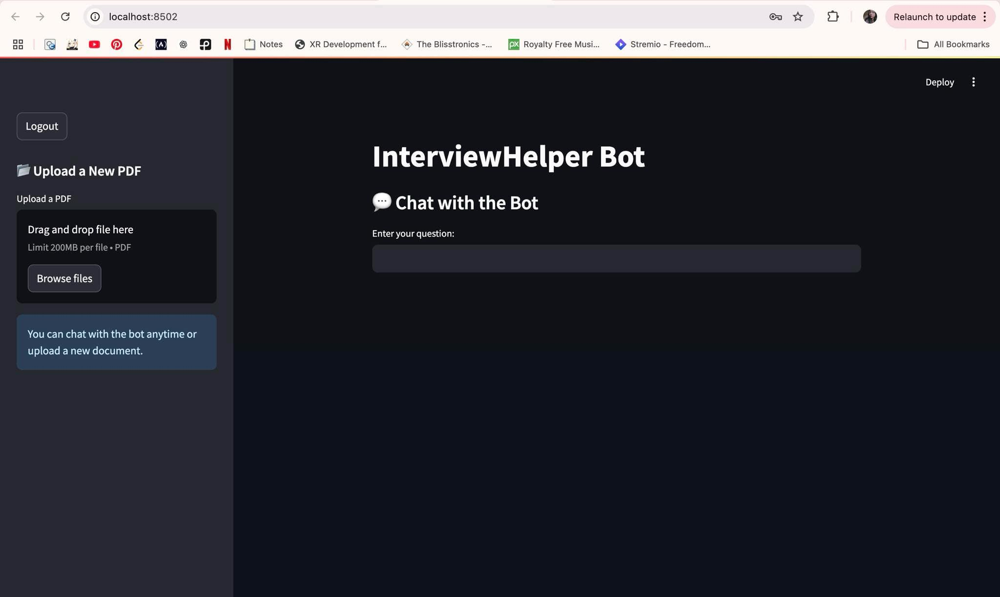
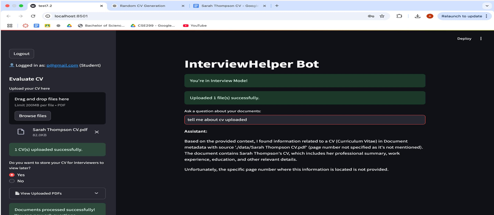
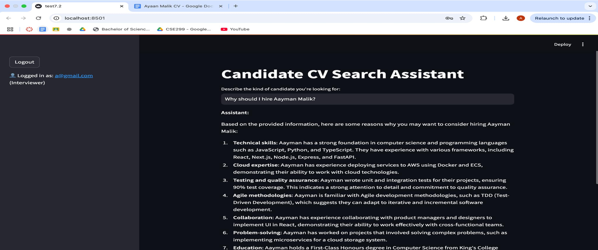
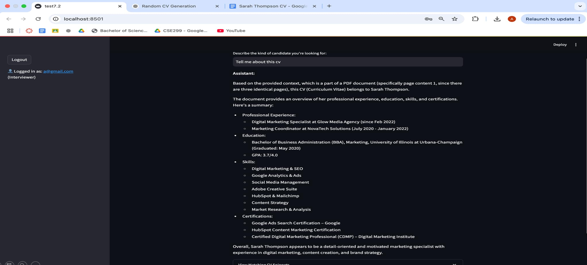
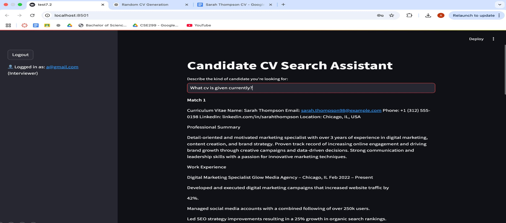
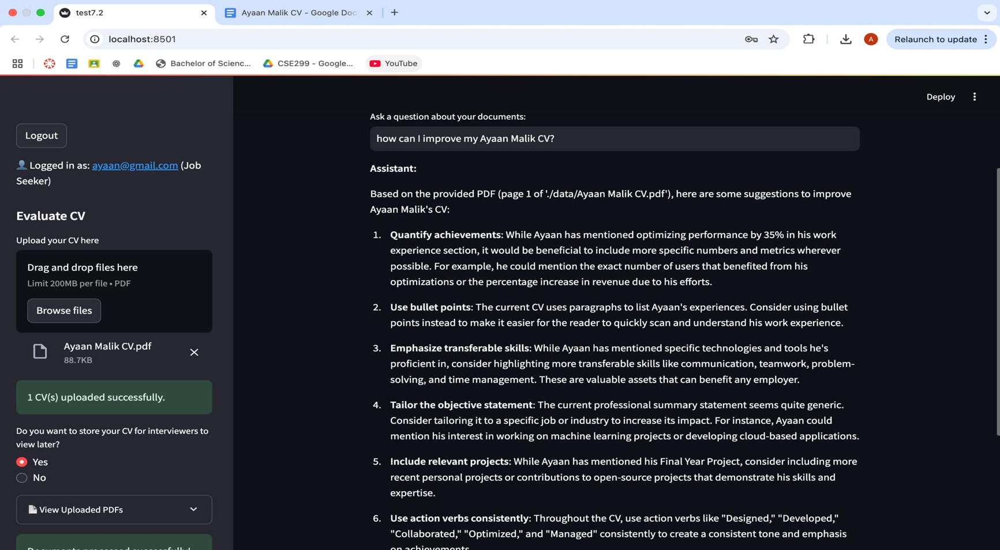

# InterviewHelper Bot (CSE299)

A Retrieval-Augmented Generation (RAG) chatbot that helps with interview preparation by generating role-relevant questions, explanations, and guided learning support. Also includes course-related Q&A support.

---

## Demo / Screenshots

### Main Chat UI


### Student View: CV Evaluation


### Interviewer View: CV Evaluation Prompt


### Candidate CV Summary Generation


### Search Interface for Candidate Matching


### Assistant Suggestions for CV Enhancement


---

## Features

- Interview preparation: common questions, explanations, tips
- Course-related Q&A support
- RAG pipeline for more grounded answers (retrieval + generation)
- Streamlit web UI
- Firebase authentication (login/signup)

---

## Architecture (RAG)

High-level flow:

**Document Loader → Text Splitter → Embeddings → Vector DB (ChromaDB) → Retriever (top-k) → LLM → Response**

---

## Tech Stack

- Python
- Streamlit
- LangChain
- ChromaDB
- Firebase Admin SDK
- pdfplumber / sentence-transformers / (optional) ElevenLabs

---

## Dataset

- “Cracking the Coding Interview” (PDF)
- Parsed via pdfplumber
- Chunked and stored as embeddings in ChromaDB

> **Note:** Dataset PDF is not included in the repository.

---

## Getting Started (Local)

### 1) Create & activate environment

```bash
python -m venv .venv

# Windows:
.venv\Scripts\activate

# macOS/Linux:
source .venv/bin/activate
```

### 2) Install dependencies

```bash
pip install -r requirements.txt
```

### 3) Firebase credentials (IMPORTANT)

This project uses **Firebase Admin SDK**.

- Put your Firebase **service account JSON** file locally (**DO NOT commit it**).
- Set the path via environment variable (recommended), or keep it as a local file.

Example (recommended):

```bash
# macOS/Linux
export GOOGLE_APPLICATION_CREDENTIALS="/path/to/serviceAccountKey.json"

# Windows (PowerShell)
$env:GOOGLE_APPLICATION_CREDENTIALS="C:\path\to\serviceAccountKey.json"
```

### 4) Run the app

```bash
streamlit run test7.py
```

---

## Project Structure

- `test7.py` — Streamlit app entry
- `requirements.txt` — dependencies
- `assets/` — screenshots used in README
- `chroma_db/` — local vector DB (ignored)

---

## Team

**CSE299 Group 1**

- Afsana Akter Tania
- Samir Mahmud
- Razwan Ahmed
- Mohaimen Al Mamun

**Guided by:** Dr. Shafin Rahman
